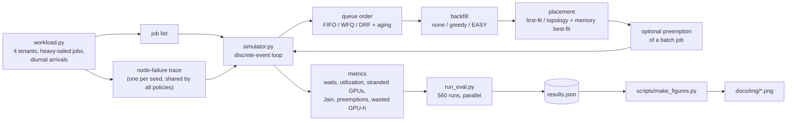
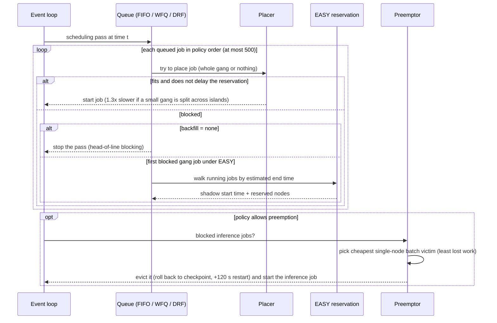
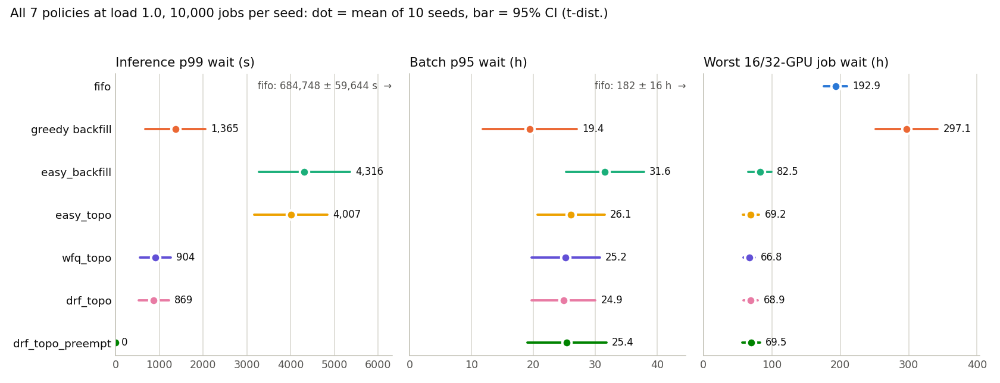
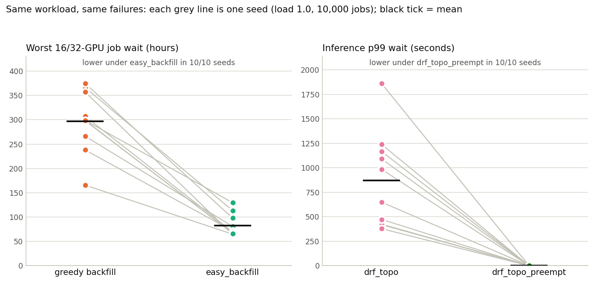
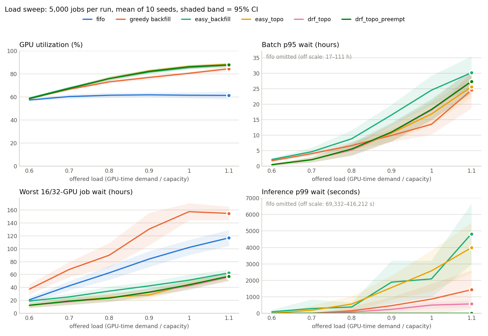

# Multi-tenant GPU Placement Simulator

> You submit a 2-minute inference job to a shared GPU box and it sits in the queue, because someone's 3-day,
> 32-GPU training run got there first. Is that bad luck or a bad scheduler? And if you "fix" it, who pays?

I couldn't get a real cluster to experiment on, so I built a small one out of Python. It's a discrete-event
simulator of a 256-GPU cluster that several groups share. I used it to pit seven scheduling policies against
each other on the same generated workloads, with the same node failures. Everything here runs in **simulated
seconds** on a laptop, with no dependencies beyond the Python standard library.

## TL;DR

All numbers are from `results.json` (load 1.0, 10 seeds × 10,000 jobs, mean ± 95% CI) unless noted.

- **Greedy backfill starves the big jobs.** The worst-off 16/32-GPU job waited **297 ± 45 h**. EASY
  reservations cut that to **82 ± 17 h**, lower in 10/10 seeds, but inference p99 rose from 1,365 s to 4,316 s.
- **Preemption fixes the inference tail.** On top of DRF it took inference p99 from **869 ± 347 s to 0 s**
  (lower in 10/10 seeds), at a cost of about **203 preemptions per 10,000 jobs**.
- **Topology-aware placement was the cheapest win.** Cross-island splits of 2–4 GPU jobs fell from 33% to
  7%, and batch p95 fell by 19,728 ± 9,566 s (paired, lower in 10/10 seeds). That gain rests on a 1.3×
  penalty I assumed.
- **Strict FIFO is unusable with gang jobs.** GPU utilization stuck at 64.5% and inference p99 was
  684,748 ± 59,644 s (about 8 simulated days).

## Architecture



## What I built

- **A cluster model with real fragmentation.** 32 nodes × 8 GPUs, two NVLink islands of 4 GPUs per node, half
  the nodes with 80 GB GPUs and half with 40 GB. Each GPU is 7 compute slices + 8 memory units and can be carved
  into A100-style MIG slices: 1g/2g/3g/7g use (1,1), (2,2), (3,4) and (7,8). So two 3g slices fill a GPU's memory
  and strand its 7th compute slice, and the same 10 GB model takes a 1g slice on an 80 GB GPU but a 2g slice
  on a 40 GB one.
- **Two kinds of jobs.**
  - *Inference (interactive):* one MIG slice, sized by memory need.
  - *Training (batch):* a **gang**. All its GPUs are granted at the same instant or none are. Up to 8 GPUs must
    sit on one node; 16- and 32-GPU jobs take 2 or 4 completely free nodes. A job needing more than 40 GB per GPU
    can only run on 80 GB nodes.
- **Topology penalty.** A ≤4-GPU job split across two islands when one island would have done runs 1.3×
  slower. That number is an **assumption**, not a measurement.
- **Failures and preemption.**
  - Each node fails on average every 10 days and takes about 2 hours to repair. The failure schedule is
    generated once per seed, so every policy hits exactly the same failures.
  - A failure kills everything on the node. A multi-node gang loses all of its nodes.
  - Batch jobs checkpoint every 30 minutes of work. An interruption throws away the work since the last
    checkpoint and adds a 120 s restart.
  - A batch job can be preempted at most twice, so everyone eventually finishes.
- **Seven policies**, each a combination of queue order, backfill rule, placement rule and preemption setting:

| policy | order | backfill | placement | preempt |
|---|---|---|---|---|
| `fifo` | arrival | none (strict head-of-line) | first-fit | no |
| `fifo_greedy_backfill` | arrival | anything that fits, no reservation | first-fit | no |
| `easy_backfill` | arrival | EASY: the first blocked gang job gets a reservation; others may jump ahead only if they won't delay it | first-fit | no |
| `easy_topo` | arrival | EASY | topology + memory-aware best-fit | no |
| `wfq_topo` | weighted fair queueing (inference weight 4, training 1) + aging | EASY | topo best-fit | no |
| `drf_topo` | weighted Dominant Resource Fairness over (compute slices, memory) + aging | EASY | topo best-fit | no |
| `drf_topo_preempt` | same as `drf_topo` | EASY | topo best-fit | interactive jobs may evict the single-node batch job that loses the least work |

- **A fair evaluation harness.** Every policy gets the same jobs and failures for a given seed. I report
  mean ± 95% t-interval over 10 seeds, plus *paired* per-seed differences, which remove the
  workload-to-workload noise. Every per-seed number is saved in `results.json`.

## How it works

The simulator has four event sources: arrivals (a pre-sorted list), completions (a heap), node failures (a
pre-generated list) and repairs (a heap). At each event time it processes completions, then repairs, failures
and arrivals, then runs **one scheduling pass**. That pass is where the policies differ:



A few details that matter:

- **Reservation timing:** EASY uses *user runtime estimates*, which I set to 1–3× the true runtime because
  people overestimate. A later job may jump ahead only if its estimate ends before the shadow time, or if it
  avoids the reserved nodes.
- **Placement:** topology-aware best-fit picks the island with the *fewest* free GPUs that still fits, which
  keeps big holes free for bigger jobs. First-fit just takes the lowest-numbered free GPUs.
- **Ordering:** WFQ gives each job a virtual finish time; DRF serves the tenant whose weighted dominant share
  (max of its compute-slice and memory fractions) is lowest. Both use **aging**: any job waiting more than
  6 hours jumps to the front.
- **Scan depth:** each pass looks at most 500 queued jobs, similar to Slurm's `bf_max_job_test`.

**Workload.**
- **Inspiration:** the shape is *inspired by* published trace studies (Microsoft Philly, ATC'19; Alibaba PAI,
  NSDI'22). Most jobs are small, a few multi-node jobs eat a big share of GPU-time, runtimes are heavy-tailed,
  and inference often needs only part of a GPU.
- **Not a replay:** I did **not** fit or replay those traces. Every parameter in `workload.py` is a guess I
  picked by hand.
- **Mix:** 60% of jobs are inference, with about 2 minutes median runtime and about 10 GB median memory.
- **Training tenants:** `train-a` runs bigger jobs, with 25% of them using 16 or 32 GPUs. `train-b` mostly
  runs 1–2 GPU jobs. Training runtimes are lognormal, with medians of 30 minutes to 2 hours, capped at 72 hours.
- **Arrivals:** they follow a daily cycle that swings ±50%.
- **Load:** the arrival rate is scaled so total GPU-time demand equals a target *offered load*. At load 1.0,
  the cluster would be exactly busy on average if scheduling were perfect.

**Metrics.**
- **Wait:** time from submission to first start.
- **Utilization:** GPU-equivalents in use, averaged over the arrival window.
- **Stranded GPUs:** free whole GPUs, averaged over time, at moments when the oldest waiting training job
  would fit by *count* but isn't running. That captures fragmentation, plus capacity EASY deliberately holds
  back for a reservation.
- **Jain's index:** computed over each tenant's mean slowdown, where slowdown = job completion time ÷
  max(runtime, 60 s). 1.0 means every tenant is slowed down equally.

## Results

`python3 run_eval.py` runs 560 simulations in total:
- **Main and high-load runs:** 7 policies × 10 seeds × 10,000 jobs at load 0.8 and at load 1.0.
- **Load sweep:** 7 policies × 10 seeds × 5,000 jobs at loads 0.6–1.1.

It took 390 s of wall-clock on an M2 MacBook (Python 3.10.8, 8 worker processes, on a machine that was busy
with other work). Every run completed all of its jobs, and every one recorded zero overcommit events. Values
are mean ± 95% CI over 10 seeds (t-distribution). Everything is in `results.json`, including every per-seed
number. The charts below are drawn straight from that file by `scripts/make_figures.py`.

### All seven policies at load 1.0



**Load 1.0, 10,000 jobs per seed** (14–16 simulated days and 37–62 node failures per seed):

| policy | inference p99 wait | inference waiting >60 s | batch p95 wait | worst 16/32-GPU job wait | GPU util | Jain | preemptions |
|---|---|---|---|---|---|---|---|
| fifo | 684,748 ± 59,644 s | 97.7% | 182 h | 193 h | 64.5% | 0.59 | 0 |
| fifo_greedy_backfill | 1,365 ± 681 s | 3.9% | 19.4 h | **297 h** | 84.3% | 0.39 | 0 |
| easy_backfill | 4,316 ± 1,042 s | 9.6% | 31.6 h | 82 h | 89.1% | 0.69 | 0 |
| easy_topo | 4,007 ± 841 s | 8.5% | 26.1 h | 69 h | 89.4% | 0.77 | 0 |
| wfq_topo | 904 ± 354 s | 3.7% | 25.2 h | 67 h | 89.2% | 0.61 | 0 |
| drf_topo | 869 ± 347 s | 3.6% | 24.9 h | 69 h | 89.2% | 0.59 | 0 |
| drf_topo_preempt | **0 ± 0 s** | **0.04%** | 25.4 h | 70 h | 89.2% | 0.52 | 203 ± 45 |

### The two trade-offs, seed by seed

Because every policy sees the same jobs and failures for a given seed, I can compare them seed by seed. Each
grey line below is one seed.



**Load 0.8** (the setting I fixed before looking at any results): the policies line up in the same order,
but the inference tail is much smaller. `drf_topo` has an inference p99 of 24 ± 50 s and `easy_topo` 679 ±
610 s, while `drf_topo_preempt` brings it to 0. For batch jobs, p95 wait is 5.0–5.3 h for the
topology-aware policies versus 8.0 h for `easy_backfill`. Strict FIFO is already broken here, with batch p95
around 101 h and GPU utilization at 64%. I added load 1.0 after seeing that at 0.8 the inference p95 is 0 for
nearly every policy, so most of the inference story lives in the tail and at higher load.

### Load sweep



(5,000 jobs per run, 10 seeds; each cell is inference p99 s / batch p95 h / worst big-job wait h):

| load | fifo | greedy backfill | easy | easy_topo | drf_topo | drf_topo_preempt |
|---|---|---|---|---|---|---|
| 0.6 | 69,332 / 17.3 / 21 | 0 / 1.8 / 37 | 90 / 2.2 / 19 | 0 / 0.5 / 12 | 0 / 0.5 / 12 | 0 / 0.5 / 12 |
| 0.8 | 221,373 / 58.4 / 63 | 152 / 6.6 / 90 | 383 / 8.8 / 34 | 560 / 5.2 / 25 | 78 / 5.2 / 24 | 0 / 5.6 / 23 |
| 0.9 | 298,681 / 79.1 / 84 | 462 / 9.9 / 130 | 1,892 / 16.6 / 42 | 1,562 / 10.7 / 28 | 237 / 10.9 / 32 | 0 / 11.0 / 33 |
| 1.0 | 362,465 / 97.0 / 102 | 862 / 13.5 / 157 | 2,089 / 24.6 / 51 | 2,579 / 16.9 / 45 | 497 / 18.1 / 43 | 0 / 18.3 / 44 |
| 1.1 | 416,212 / 111.3 / 117 | 1,430 / 24.6 / 155 | 4,825 / 30.2 / 63 | 3,984 / 25.6 / 56 | 569 / 27.3 / 56 | 0 / 27.4 / 57 |

(`results.json` also has the 0.7 row and `wfq_topo`, which sits within noise of `drf_topo` in every row. The
chart leaves `wfq_topo` out for the same reason.)

### What surprised me

1. **Strict FIFO collapses even at 60% load.** One 32-GPU job at the head of the queue waits for 4 whole
   nodes to drain, and everything else waits behind it. In the 10,000-job runs, 52–54 whole GPUs sat idle on
   average while the oldest training job would fit by count (about 43 at load 0.6 in the smaller sweep runs).
   FIFO's utilization stayed between 57% and 65% in every run from load 0.6 to 1.1.
2. **Greedy backfill looks great until you check the big jobs.** It has the best batch p95 at load 1.0
   (19.4 h), but the worst-off 16/32-GPU job waited **297 ± 45 h**, because small jobs keep jumping into
   every gap. EASY reservations cut that to 82 ± 17 h, lower in 10/10 seeds. The price is real: reserved
   nodes sit partly idle, so inference p99 rose from 1,365 s to 4,316 s and batch p95 from 19.4 h to 31.6 h.
   There's no free lunch, just a choice about who waits.
3. **Topology awareness was the cheapest win.** Under first-fit, 33% of 2–4 GPU training jobs got split
   across NVLink islands. Topology-aware best-fit cut that to 7% at load 1.0 and to 2.5% at load 0.8. Because
   of the assumed 1.3× penalty, batch p95 fell by 19,728 ± 9,566 s (paired per seed, lower in 10/10) at load
   1.0. That gain depends directly on the 1.3× number, which I made up.
4. **WFQ and DRF behaved almost identically.** With EASY backfill, the ordering mostly decides *which*
   blocked job gets the reservation. Both rules put the light inference tenants first and the lighter
   training tenant ahead of the heavy one. At load 0.8 their batch p95 was exactly equal in 8 of 10 seeds.
5. **Preemption fixes the inference tail and looks almost free here, but it shuffles fairness.** At load 1.0,
   preemption took inference p99 from 869 s to 0 s, lower in 10/10 seeds (paired difference −869 ± 347 s).
   Inference jobs waiting more than 60 s fell from 3.6% to 0.04%. That cost about 203 preemptions per 10,000
   jobs. The change in batch p95 (+1,899 ± 6,373 s) and wasted GPU-hours (+11 ± 21) was within noise, partly
   because victims are chosen to lose the least un-checkpointed work. Jain's index dropped from 0.59 to 0.52,
   because inference got much faster and training didn't, so the tenants' slowdowns spread further apart.
   Whether that's "unfair" depends on whether you think inference *should* be faster.

### What the numbers do NOT show

- **Nothing about real latency or real GPUs.** These are simulated seconds on a synthetic workload. The
  absolute numbers mean nothing outside this model; only the comparisons between policies on identical inputs
  carry information, and even those depend on my parameter guesses.
- **The topology gain is not real-world sized.** It comes straight from the 1.3× penalty I assumed. Set it to
  1.0 and it should mostly vanish.
- **Preemption is not free in general.** Its low cost here depends on 30-minute checkpoints, a 120 s restart,
  instant eviction, and only evicting single-node jobs. The "0 s" p99 is partly an artifact of eviction being
  instantaneous in this model.
- **The CIs are wide on purpose.** A few 32-GPU, multi-day jobs dominate some seeds. Read the ± values and the
  paired comparisons in `results.json`, not just the means.

## Run it yourself

**Prerequisites:** Python 3.10+ (I used 3.10.8). The simulator, demo, eval and tests use only the standard
library. matplotlib is only needed to redraw the charts.

```sh
git clone https://github.com/nikhils23j/multi-tenant-gpu-placement-simulator.git
cd multi-tenant-gpu-placement-simulator
# no install step for the simulator itself; for the charts only:
python3 -m pip install matplotlib
```

**Quickstart** (one seed, all policies, one table; took about 3 s here):

```sh
python3 run_demo.py
python3 run_demo.py --load 1.1 --seed 7 --policies easy_topo drf_topo_preempt
python3 run_demo.py --mtbf-days 0                  # turn node failures off
python3 run_demo.py --frac-80gb 0.25               # fewer big-memory nodes
```

**Full evaluation** (the 560 runs behind the tables above; 390 s on my 8-core M2 while it was busy):

```sh
python3 run_eval.py                                # rewrites results.json
python3 run_eval.py --quick --output results_quick.json   # 3 seeds, smaller sweep
python3 scripts/make_figures.py                    # redraws docs/img/*.png from results.json
```

Note that `run_eval.py` writes to `results.json` by default, so pass `--output` for a quick run if you want
to keep the recorded results.

Things worth poking at:
- **Model constants:** `TOPOLOGY_PENALTY`, `CHECKPOINT_INTERVAL`, `RESTART_OVERHEAD`, `MAX_PREEMPTIONS` and
  `AGE_LIMIT` at the top of `simulator.py`. Set the penalty to 1.0 and the topology win should mostly vanish.
  Push the restart cost up and preemption should start to hurt batch jobs.
- **Workload shape:** the dictionaries in `workload.py`. Making `train-a` even more top-heavy is how you
  get FIFO to look even worse.
- **New policies:** add an entry to `POLICIES` and both the demo and the eval pick it up.

## Tests

```sh
python3 -m unittest -v test_simulator.py          # 14 tests, well under a second
```

What the tests check:
- An independent replay of every allocation shows no GPU's slices or memory are ever overcommitted (and
  nothing leaks), under all 7 policies, with failures and preemption on.
- Every gang gets exactly its GPU count at a single instant: whole GPUs, on one node for ≤8 GPUs, or on
  `gpus/8` whole nodes for bigger jobs.
- Every job completes.
- Memory-type constraints hold, and MIG profiles are sized correctly for 40 GB vs 80 GB GPUs.
- Same seed gives identical metrics.
- There are hand-built scenarios for head-of-line blocking, EASY protecting the reserved job when greedy
  backfill delays it, topology placement and its slowdown, checkpoint rollback arithmetic, a failure killing
  a whole 2-node gang, and input validation.

## Project layout

```
.
├── simulator.py           cluster model, policies, discrete-event loop, metrics
├── workload.py            synthetic tenants, jobs, arrivals and node-failure traces
├── run_demo.py            one seed, all policies, one table
├── run_eval.py            full evaluation (560 runs, parallel) -> results.json
├── results.json           recorded evaluation, including every per-seed number
├── test_simulator.py      14 unittest cases
├── scripts/
│   └── make_figures.py    draws docs/img/*.png from results.json only
└── docs/img/              README charts
```

## What this isn't / limits

- **Not a real cluster.** No GPUs, Kubernetes, Slurm or CUDA. Times are simulated seconds, and "GPU
  utilization" is a counter.
- **Not trace-driven.** The workload is synthetic and only loosely shaped like published studies, so the
  absolute numbers mean nothing outside this model. Only the comparisons between policies on identical
  inputs carry information, and even those depend on my parameter guesses.
- **Simplified hardware.**
  - The 1.3× cross-island penalty, 30-minute checkpoints and 120 s restarts are assumptions.
  - Real MIG has placement rules about which slices can coexist; I only check slice and memory counts.
  - Jobs on a GPU don't interfere with each other.
  - There's no network or storage, and no multi-node placement cost beyond "whole free nodes".
- **Heavy-tailed means noisy.** A few 32-GPU, multi-day jobs dominate some seeds, which is why several CIs
  are wide. Read the ± values and the paired comparisons in `results.json`, not just the means.
